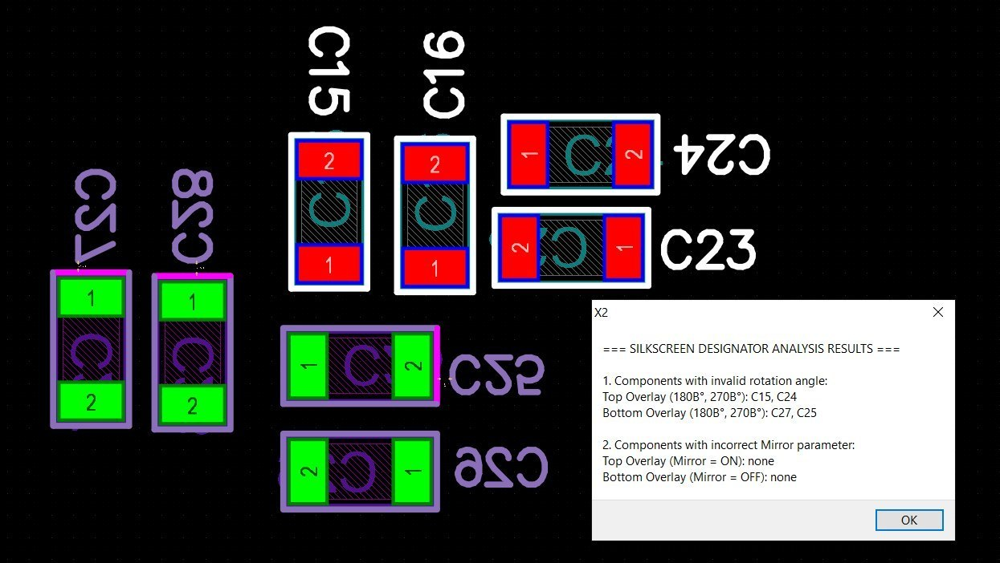
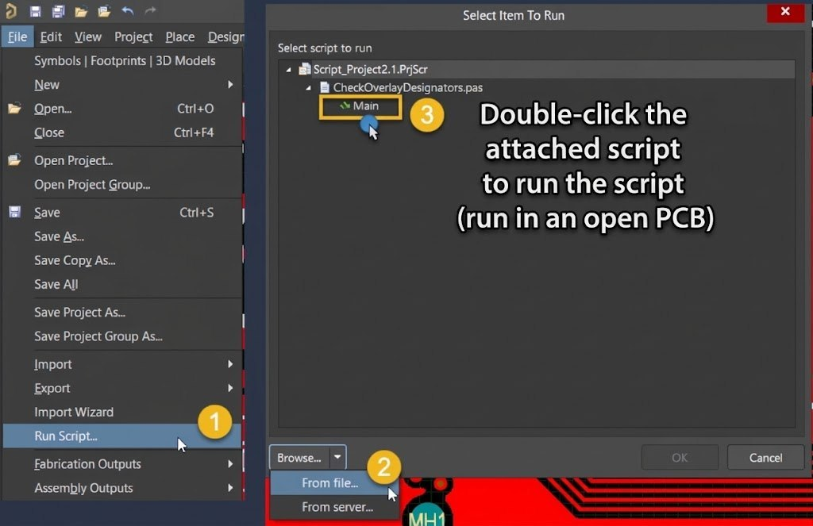

# Check Overlay Designators — Altium Designer Script

**Check Overlay Designators** is a script (DelphiScript / `.pas`) for the **Altium Designer PCB editor**. It checks the currently open `*.PcbDoc` file for silkscreen text orientation and mirroring errors in component **Designator** texts on the **Top Overlay** and **Bottom Overlay** layers.

Essentially, it is a supplement to the built-in DRC check: standard Altium rules do not verify the readability of designator silkscreen text, while this script detects such errors and reports them in a single report.

*The script in action: checking Designator text orientation in the Altium Designer PCB editor.*

---

## What the Script Checks

The script iterates over all text primitives on the overlay layers and checks **Designator texts only** (hidden designators are skipped). Two types of errors are detected:

### 1. Invalid Text Orientation (Rotation)

A Designator text rotated upside down or sideways is considered unreadable:

| Layer | Valid angles | Invalid angles |
|---|---|---|
| Top Overlay | 0°, 90° | **180°, 270°** |
| Bottom Overlay | 0°, 90° | **180°, 270°** (accounting for mirroring) |

### 2. Incorrect Mirroring (Mirror)

| Layer | Correct | Error |
|---|---|---|
| Top Overlay | Mirror = OFF | **Mirror = ON** |
| Bottom Overlay | Mirror = ON | **Mirror = OFF** |

## How to Use

1. Open the desired `*.PcbDoc` file in Altium Designer.
2. Attach and run the script (see the [Installation and Running](#installation-and-running) section).
3. After the check completes, an information window appears listing the components grouped by error type.
4. After closing the window, the script offers to **save the report to a txt file** — useful for record keeping or handing off to a designer.

## Installation and Running

The script requires no installation: simply attach the `.pas` file via the **Files → Run Script** panel (DXP → Run Script) in Altium Designer.

*Attaching and running the script via the Altium Designer panels.*

Step by step:

1. Choose the script language version and save the desired file locally.
2. In Altium Designer, open the **Files** panel → **Run Script** (or DXP → Run Script).
3. Click **Browse…**, specify the path to the script file, select the `Main` procedure, and click **OK**.
4. The script will check the currently open PCBDoc and display the results.

## Script Files

The script is distributed in three language versions — the checking algorithm is identical; only the language of the messages in the UI and reports differs:

| File | Message language |
|---|---|
| [CheckOverlayDesignators v.2.2_EN.zip](Scripts/CheckOverlayDesignators v.2.2_EN.zip) | English |
| `CheckOverlayDesignators v.2.2_RU.zip` | Russian |
| `CheckOverlayDesignators v.2.2_UA.zip` | Ukrainian |

## Compatibility

- The script has been tested with **Altium Designer 2024**.
- Only the currently open `*.PcbDoc` document is checked; it must be opened before running the script.

## License

The author wrote the script for personal use, has not patented it, and makes no copyright claims. The script is distributed **without a license** — use it freely, "as is", without any warranty.
