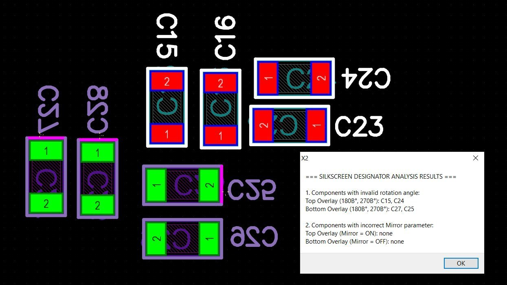
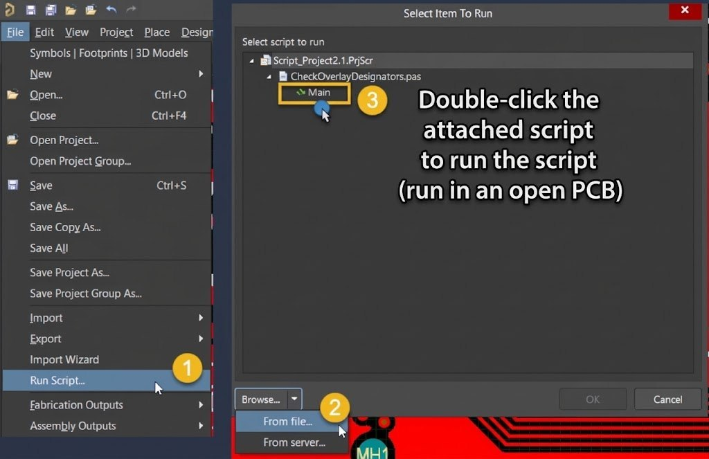

# Check Overlay Designators — скрипт для Altium Designer

**Check Overlay Designators** — скрипт (DelphiScript / `.pas`) для **PCB-редактора Altium Designer**. Проверяет текущий файл `*.PcbDoc` на ошибки ориентации и отзеркаливания шелкографии текста **Designator** (обозначений компонентов) на слоях **Top Overlay** и **Bottom Overlay**.

По сути это дополнение к штатной DRC-проверке: стандартные правила Altium не контролируют читаемость обозначений на шелкографии, а скрипт находит такие ошибки и выводит их одним отчётом.

*Скрипт в работе: проверка ориентации текста Designator в PCB-редакторе Altium Designer.*

---

## Что проверяет скрипт

Скрипт обходит все текстовые примитивы на слоях шелкографии и проверяет **только тексты Designator** (скрытые обозначения пропускаются). Выявляются два типа ошибок:

### 1. Неверная ориентация текста (Rotation)

Текст Designator, повёрнутый «вверх ногами» или боком, считается нечитаемым:

| Слой | Правильные углы | Ошибочные углы |
|---|---|---|
| Top Overlay | 0°, 90° | **180°, 270°** |
| Bottom Overlay | 0°, 90° | **180°, 270°** (с учётом отзеркаливания) |

### 2. Неверное отзеркаливание (Mirror)

| Слой | Правильно | Ошибка |
|---|---|---|
| Top Overlay | Mirror = OFF | **Mirror = ON** |
| Bottom Overlay | Mirror = ON | **Mirror = OFF** |

## Как пользоваться

1. Откройте в Altium Designer нужный файл `*.PcbDoc`.
2. Подключите и запустите скрипт (см. раздел [Установка и запуск](#установка-и-запуск)).
3. После проверки появится информационное окно со списком компонентов по каждому типу ошибки.
4. После закрытия окна скрипт предложит **сохранить отчёт в txt-файл** — можно сохранить для истории или передачи разработчику.

## Установка и запуск

Скрипт не требует установки: достаточно подключить файл `.pas` через панели **Files → Run Script** (DXP → Run Script) в Altium Designer.

*Подключение и запуск скрипта через панели Altium Designer.*

Пошагово:

1. Выберите язык версии скрипта и сохраните нужный файл локально.
2. В Altium Designer откройте панель **Files** → **Run Script** (или DXP → Run Script).
3. Нажмите **Browse…**, укажите путь к файлу скрипта, выберите процедуру `Main` и нажмите **OK**.
4. Скрипт выполнит проверку открытого PCBDoc и покажет результаты.

## Файлы скриптов

Скрипт распространяется в трёх языковых версиях — алгоритм проверки одинаковый, отличаются языки сообщений в интерфейсе и отчётах:

| Файл | Язык сообщений |
|---|---|
| [CheckOverlayDesignators_v.2.2_EN.zip](Scripts/CheckOverlayDesignators_v.2.2_EN.zip) | Английский |
| [CheckOverlayDesignators_v.2.2_UA.zip](Scripts/CheckOverlayDesignators_v.2.2_UA.zip) | Украинский |
| [CheckOverlayDesignators_v.2.2_RU.zip](Scripts/CheckOverlayDesignators_v.2.2_RU.zip) | Русский |

## Совместимость

- Скрипт проверен на **Altium Designer 2024**.
- Проверяется только текущий открытый документ `*.PcbDoc`; перед запуском его нужно открыть.

## Лицензия

Автор писал скрипт для себя, не патентовал и нигде не публиковал с заявлением прав. Скрипт распространяется **без лицензии** — пользуйтесь свободно, «как есть», без каких-либо гарантий.
